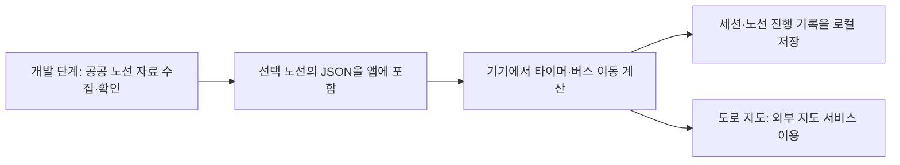

# 일상용 생산성 앱 아이디어와 ‘서울 집중 버스’ 검토

조사일: 2026년 10월 11일 · iPhone 우선 · 자체 서버 없는 1인 사이드 프로젝트

## 1. 추천

**이번 방향에서는 ‘서울 집중 버스’를 가장 먼저 작은 시제품으로 검증하는 것을 추천한다.** 메모·할 일 앱보다 구현할 부분은 많지만, “집중하면 내가 아는 서울 동네를 버스로 지나간다”라는 설명과 화면이 분명하다. 사용자가 제안한 도로 지도 위 이동도 기술적으로 검토 가능한 데이터가 있다.

가장 빨리 첫 앱을 출시하는 것이 목적이라면 ‘오늘 세 가지’, 실생활에서 자주 꺼내는 작은 도구라면 ‘잠깐 메모’가 대안이다. 다만 이 두 후보는 기본 앱으로도 해결하기 쉬워, 유료 구매 이유는 더 약할 수 있다.

이번 보고서는 공식 제품 설명·공공데이터 명세·Apple 문서에 근거한다. 앱 실사용 비교, 집중력 개선 효과, 시장 수요와 지불 의향은 검증하지 않았다. 버스 API의 인증키 발급과 실제 노선 응답도 확인하지 않았으므로 **명세상 가능성과 실제 데이터 확보 완료를 구분한다.**

## 2. 더 간단한 일상 앱 4개

| 아이디어 | 실생활 사용 예 | 딱 필요한 첫 기능 | 기존 제품 대비 차별화 가설 | 판단 |
|---|---|---|---|---|
| **잠깐 메모** | 주차 위치·택배 번호·오늘 물어볼 것 | 한 줄/사진, 오늘·내일·보관 선택, 위젯, 만료 보관함 | 오래 보관하는 노트보다 유효기간 짧은 생활 정보를 자동 정리 | 생활 도구로 추천 |
| **오늘 세 가지** | 오늘 꼭 처리할 일 3개만 고르기 | 최대 3개, 체크, 저녁에 내일·취소 선택 | 매일 쌓이는 목록 대신 오늘의 선택에 제한을 둠 | 출시가 가장 쉬운 후보 |
| **준비 시작 캘린더** | 약속 3시, 준비 30분·이동 40분이면 1시 50분부터 준비 | 일정, 준비·이동 시간 수동 입력, 준비/출발 알림, 오늘 위젯 | 약속 시각보다 실제 행동 시작 시각을 앞세움 | 기본 캘린더와 겹쳐 후순위 |
| **서울 집중 버스** | 독서 25분 동안 서울 노선의 한 구간 이동 | 할 일 한 줄, 시간 선택, 노선 지도, 가상 버스, 완료 기록 | 익숙한 동네·짧은 집중·다음 날 이어 타기 | 콘셉트 검증 1순위 |

### 잠깐 메모

[Drafts](https://docs.getdrafts.com/gettingstarted/)는 빠른 텍스트 기록과 이후 관리·실행을 이미 제공한다. 따라서 ‘빨리 쓰는 메모’만으로는 약하다. 제안의 중심은 **필요가 끝난 메모가 홈 화면에서 사라지고 보관함에 남는 것**이다. 자동 영구삭제는 하지 않는다.

예: “B2 C17 주차”를 오늘까지 표시 → 다음 날 보관함 이동. 사진과 텍스트를 함께 저장하고 검색·복구할 수 있다. 폴더·태그·문서 편집·AI를 빼면 앱을 작게 유지할 수 있다. 위젯에 어떤 내용을 노출할지 사용자가 선택하게 한다.

약점은 Apple 메모·미리 알림을 별도 앱으로 대체할 만큼 편리해야 한다는 점이다. 기본 사용은 무료, 여러 위젯·표시 스타일을 일회성 결제로 시험할 수 있지만 지불 의향은 미검증이다.

### 오늘 세 가지

[Twos](https://twosapp.com/)는 메모·할 일·알림·일정을 통합하고 미완료 할 일의 이월을 소개한다. 제안은 더 많은 통합 기능보다 **하루에 세 가지만 고르는 화면**에 집중한다. 저녁에는 남은 일을 무조건 이월하지 않고 내일·취소 중 선택한다.

서버·캘린더 연결 없이 기기 안에서 동작하도록 만들 수 있다. 개발은 단순하지만 유료 가치가 가장 약할 수 있다. 이미 다른 할 일 앱을 쓰는 사람에게 ‘선택하는 수고가 줄어드는지’부터 확인해야 한다.

### 준비 시작 캘린더

[Structured](https://structured.app/)는 일정과 할 일의 타임라인·캘린더 가져오기를 제공한다. [Apple 캘린더](https://support.apple.com/guide/iphone/create-and-edit-events-in-calendar-iph3d110f84/ios)도 주소를 넣으면 지도·교통 정보를 이용한 출발 안내를 제공한다. 출발 알림 자체를 새 기능으로 주장할 수 없다.

차별 가설은 ‘샤워 15분·준비물 5분·이동 40분’처럼 **준비 루틴부터 거꾸로 계산하는 화면**이다. 첫 버전은 직접 입력한 일정과 고정 시간으로 계산해 외부 API를 없앤다. 다음 단계에서만 기존 캘린더 가져오기를 검토한다. 실시간 교통을 반영한 정확한 출발 시각을 약속하지 않는다.

## 3. FocusFlight와 비교하면 어떤가

사용자가 언급한 제품은 Cement Planet LTD의 [FocusFlight, App ID 6648771147](https://apps.apple.com/us/app/focusflight-deepfocus-timer/id6648771147)을 기준으로 확인했다. App Store가 연결하는 도메인은 `focus.flights`다. 검색에 나온 동명 사이트들과 혼동하지 않았다.

| 제품 | 확인한 특징 | 서울 버스 앱이 그대로 따라 해서는 약한 부분 |
|---|---|---|
| [FocusFlight](https://apps.apple.com/us/app/focusflight-deepfocus-timer/id6648771147) | 비행 여정·탑승권·3D 지도와 경로·기록·앱 차단·백색소음·한국어 | 여행형 집중, 지도에서 이동, 티켓, 한국어 |
| [FocusTrain](https://apps.apple.com/us/app/focustrain-pomodoro-timer/id6800457256) | 실제 유럽 철도망의 역·선로, 시간에 맞는 목적지, 열차 소리·앱 차단·완료 티켓 | 실제 교통 노선을 집중 여행에 사용 |
| [Focus Traveller](https://apps.apple.com/us/app/focus-traveller-flow-timer/id1559730367) | 집중할수록 산을 오르는 여행자, 타이머·휴식·환경·기록 | 집중 시간을 이동과 성장으로 시각화 |

**‘비행기를 버스로 바꿈’만으로는 차별이 크지 않다.** 이번 조사에서는 실제 교통망을 쓰는 기차 집중 앱까지 확인됐다. 그러나 서울 버스의 친숙함을 이용한 제품은 별도로 실험할 가치가 있다. ‘세계 어디든 여행’보다 **내가 아는 동네를 조금씩 완주하는 경험**으로 방향을 잡는 것이다. 서울 버스 집중 앱이 시장에 전혀 없다는 결론은 내리지 않는다.

추천할 차별 가설은 세 가지다.

1. **익숙한 장소:** 자주 지나는 정류장·한강·동네 이름이 집중의 진행을 보여 준다. 현재 위치 권한은 필요 없다.
2. **짧은 일상 집중:** 15·25·50분을 먼저 고르고 구간을 선택한다. 첫 화면에서 복잡한 출발지·환승 검색을 하지 않는다.
3. **이어 타기:** 오늘 일부 구간을 집중으로 이동하고 내일 같은 노선에서 이어 간다. 한 번의 집중은 ‘구간 도착’, 여러 번의 집중은 ‘노선 완주’로 구분한다.

지도 이동이 집중에 도움이 되는지는 가설이다. 집중 중 지도를 계속 만지게 되면 목적과 충돌하므로 이동 화면은 조용하게 두고, 자유 탐색과 수집 기록은 종료 후에 제공하는 편이 낫다.

## 4. 추천하는 사용 흐름

**“할 일 하나를 적고, 버스를 타고, 도착할 때까지 집중한다.”**

1. “책 20쪽 읽기”를 적거나 최근 할 일을 선택한다.
2. 25분을 선택한다.
3. 추천 구간 3개 중 하나를 고른다. 이 구간의 시간은 집중용 설정이며 실제 운행 시간은 아니다.
4. 도로 지도 위에 실제 경로를 그리고 가상 버스가 천천히 이동한다. 남은 시간·현재 진행·다음 정류장만 보여 준다.
5. 폰을 잠그고 집중한다. 다시 열면 경과 시간에 맞는 위치를 보여 준다.
6. 완료 알림 후 ‘25분 세션 완료’를 기록하고, 사용자가 할 일을 끝냈는지 체크한다. 남은 노선은 다음 세션에서 이어 간다.

타이머가 끝났다는 사실과 실제로 집중·작업을 완료했다는 사실은 구분한다. 집중 여부를 자동 검증했다고 표현하지 않는다. 사용자가 화면을 껐다는 이유로 실패시키지도 않는다.

가상 버스이므로 GPS로 사용자를 추적하거나 실제 버스의 도착 정보에 맞출 필요가 없다. 교통 안내 앱과 혼동하지 않도록 ‘집중용 가상 여행’과 데이터 기준일을 표시한다.

## 5. 서울 공공데이터로 구현 가능한가

**공식 명세상 필요한 재료가 있다.** 다만 ‘정류장을 선으로 잇는 노선도’와 ‘도로를 따라가는 실제 경로’는 데이터가 다르다.

| 필요한 재료 | 확인한 공식 데이터 | 쓰임 |
|---|---|---|
| 정류소 이름·위치 | [서울시 버스정류소 위치정보, OA-15067](https://data.seoul.go.kr/dataList/OA-15067/S/1/datasetView.do) | 정류소 표시. 조사 시 목록에 2026.09.02 XLSX 존재 |
| 노선명·기종점 | [서울시 버스노선 기본정보, OA-15262](https://data.seoul.go.kr/dataList/OA-15262/F/1/datasetView.do) | 노선 선택과 방향 표시 |
| 정류소 순서·좌표 | [서울특별시 노선정보조회 서비스, 15000193](https://www.data.go.kr/data/15000193/openapi.do)의 `getStaionByRoute` | `seq`, `stationNm`, `gpsX/Y`, 방향·회차 정보 |
| 실제 지도상 경로 | 같은 [노선정보조회 서비스](https://www.data.go.kr/data/15000193/openapi.do)의 경로 조회 | 기능명 `getRoutePathList`, 엔드포인트 `getRoutePath`, 순번 `no`와 `gpsX/Y` 등 |
| 경로 데이터 설명 | [서울시 버스노선경로 목록정보, OA-15264](https://data.seoul.go.kr/dataList/OA-15264/L/1/datasetView.do) | 경로 순번·좌표 제공 설명. 이 페이지에는 다운로드 파일 없음 |

정류소 위치만 직선으로 연결하면 강·건물·커브를 가로지를 수 있다. 사용자가 원하는 도로 위 이동에는 **경로 좌표를 순서대로 연결**해야 한다. 목적지 자동차 길찾기를 호출하는 것으로 실제 버스 경로를 대체하지 않는다.

구현 전에 선택 노선 1개를 실제 조회해 좌표·진행 방향·회차·정류소 매칭을 확인해야 한다. 파일 페이지에는 좌표계 설명이 혼재돼 있어 파일을 확인 없이 지도에 넣지 않는다. 경로 API의 WGS84 `gpsX/Y`와 실제 값의 범위를 확인하는 편이 안전하다.

### 이용 조건

정류소·노선 기본정보·경로 설명 페이지에는 **공공누리 1유형: 출처표시, 상업적 이용 및 변경 가능**이 명시돼 있다. 이는 유료 앱에 재가공 데이터를 쓰는 방향을 뒷받침한다. 앱 정보에 제공기관·데이터명·원문 링크·기준일·가공 사실을 표시하는 구성을 권한다. [정류소 이용 조건](https://data.seoul.go.kr/dataList/OA-15067/S/1/datasetView.do), [경로 이용 조건](https://data.seoul.go.kr/dataList/OA-15264/L/1/datasetView.do)

노선 API 화면도 출처표시 제1유형을 명시하지만, JSON 카탈로그에는 제3자 권리 문구가 함께 있어 표시가 완전히 일치하지 않는다. 출시용으로 확보한 자료의 최신 이용 조건과 출처 표시를 확인해야 한다. 이 데이터의 허락이 지도 배경·사진·회사 로고·방송 음원의 사용까지 포함하는 것은 아니다. [노선 API 이용 조건](https://www.data.go.kr/data/15000193/openapi.do)

## 6. 자체 서버 없이 만드는 구조

추천 구조는 **개발할 때 노선 데이터를 준비하고 앱에 포함하는 것**이다.

첫 버전은 노선 5개, 각 노선의 추천 구간만 준비한다. 사용자 앱에서 매번 공공 API를 호출하지 않으면 인증키 배포·호출량·API 장애를 런타임에서 관리할 필요가 없다. 노선 변경은 다음 앱 업데이트에 반영하고, 표시된 경로는 데이터 기준일의 집중 콘텐츠로 취급한다.

공식 노선 API는 무료·인증키 필요·개발/운영 자동승인·개발계정 신청 가능 트래픽 1,000으로 안내돼 있다. 운영계정 증설은 별도 신청 방식이다. 모바일 직접 호출·HTTPS·실제 데이터 반환은 이번에 검증하지 않았으므로 앱 직접 연동이 확정됐다고 보지 않는다. [공식 API 안내](https://www.data.go.kr/data/15000193/openapi.do)

### 지도는 두 가지 선택이 있다

| 선택 | 장점 | 제약 | 추천 |
|---|---|---|---|
| **Apple MapKit 도로 지도 + 경로·버스** | 사용자가 원한 실제 거리 지도에 가까움 | 외부 지도 통신 의존. 완전 오프라인 배경지도 보장 불가 | 이번 아이디어의 시제품에 우선 사용 |
| **직접 그린 서울 지도·노선도** | 로컬 자산으로 핵심 화면을 오프라인 제공 가능 | 도로·건물 디테일 제작이 필요하고 실제 지도와 다름 | 오프라인 대체 화면으로 단순하게 제공 |

MapKit은 앱에 지도와 표시 요소를 넣고, `MapPolyline`은 좌표를 연결한 선을 표시한다. 따라서 앱 자체 서버 없이 도로 지도와 노선을 함께 표시하는 구조가 가능하다. [MapKit](https://developer.apple.com/documentation/mapkit), [MapPolyline](https://developer.apple.com/documentation/mapkit/mappolyline)

**노선 좌표를 앱에 넣었다고 배경지도까지 오프라인이 되는 것은 아니다.** Apple의 개발자 지원 답변도 시스템 지도의 사전 로딩 API가 없고 Apple Maps의 오프라인 콘텐츠가 앱에 제공되지 않는다고 설명한다. 온라인 도로 지도와 오프라인 단순 노선도를 구분해서 설계한다. [Apple DTS 답변](https://developer.apple.com/forums/thread/772258)

화면을 잠그면 일반 앱은 계속 애니메이션을 실행할 수 없다. 타이머는 시작·종료 시각과 일시정지를 저장하고, 재진입 때 진행률과 위치를 계산하는 방식으로 설계한다. 완료 알림은 로컬로 예약한다. 백그라운드에서 지도를 계속 렌더링하는 구조는 필요 없다. [Apple 백그라운드 실행 문서](https://developer.apple.com/documentation/uikit/extending-your-app-s-background-execution-time)

다른 앱 차단은 추가 기능으로 본다. Screen Time 기반 차단을 배포하려면 Family Controls 권한에 대한 Apple 승인이 필요하므로 첫 타이머와 따로 검토한다. 이는 서버 요구가 아니라 배포 권한과 구현 범위의 문제다. [Apple Family Controls 배포 안내](https://developer.apple.com/documentation/familycontrols/requesting-the-family-controls-entitlement)

## 7. 첫 버전에 넣을 것

**화면은 세 개로 시작한다.**

| 화면 | 내용 |
|---|---|
| 출발 | 할 일 한 줄·15/25/50분·추천 구간 선택 |
| 이동 | 도로 지도·경로·작은 가상 버스·남은 시간·일시정지/중단 |
| 도착/기록 | 완료 시간·할 일 체크·노선 진행·다음에 이어 타기 |

노선 5개, 단순한 버스 일러스트 1종, 로컬 기록·백업, 완료 알림으로 시작한다. 로그인·친구 동승·실시간 버스·자동 환승·3D 차창 풍경·노선 전체 검색·대형 보상 시스템은 첫 버전에서 제외한다. 특히 경로 위 이동과 차창 밖 실제 거리 영상은 제작 범위가 크게 다르다.

버스 소리는 선택 사항이다. 쓸 경우 직접 제작하거나 사용 허락이 확인된 짧은 배경음부터 시작한다. 정류장마다 말하는 안내 방송은 처음부터 넣지 않는다. 지도는 앱이 보이는 동안에만 조용하게 움직이고, 평소에는 화면을 끄고 사용할 수 있게 한다.

### 기간과 수익화의 실험안

SwiftUI 경험이 있는 1인이 주 10–15시간 작업한다는 가정에서, 간단 메모·3개 할 일 앱은 대략 3–5주, 지도 포함 버스 MVP는 6–10주를 계획 범위로 잡을 수 있다. 노선 API 확인·데이터 정리·타이머 복구·지도/오프라인 상태·기본 결제·QA를 포함한 추정이며 사용자 조사와 심사 대기는 별도다. 실제 API 품질과 UI 완성도에 따라 달라진다.

버스 앱은 무료 노선 2개와 기본 타이머를 제공하고, 나머지 노선·야간 테마·기록 꾸미기를 일회성 6,600–12,000원에 시험하는 안을 추천한다. 가격은 시장 조사로 검증한 수치가 아니다. 수집한 공공데이터의 독점성이 아니라 집중 경험·표현·편의에 가치를 둔다. 단순 지역 버스 테마에 매월 돈을 낼 이유는 아직 확인되지 않아 초기 구독은 우선하지 않는다.

## 8. 가장 먼저 검증할 것

전체 앱을 만들기 전에 **선택 노선 1개 + 25분 타이머 + 지도 위 버스 이동**만 확인한다. 기술 검증에서는 경로가 도로와 맞는지, 잠금·앱 재실행 후 진행이 맞는지, 네트워크가 끊겨도 세션은 유지되는지 확인한다.

사용자 검증은 평범한 숫자 타이머와 같은 길이의 버스 타이머를 5–8명에게 교차 사용하게 하는 방식으로 제안한다. ‘예쁘다’보다 실제로 다음 세션에서도 선택하는지, 지도 때문에 폰을 더 자주 보는지, 익숙한 정류장이 동기를 주는지를 살핀다. 이 실험을 실제로 수행한 것은 아니다.

**버스 화면을 한 번 보고 끝난다면 테마의 장기 가치가 약하다.** 숫자 타이머보다 시작이 편하고, 노선의 다음 구간 때문에 다시 쓰며, 화면을 오래 보지 않아도 만족할 때 이 아이디어를 확장할 이유가 생긴다.

## 9. 조사 결론

이번 요청에는 큰 업무 관리 도구보다 **한 줄 할 일에 붙는 서울 버스 집중 타이머**가 더 적합한 후보다. 공공 경로 데이터를 이용할 기술적 근거가 있고, 자체 서버 없이도 만들 수 있는 구조다. 다만 외부 지도 사용과 완전 오프라인은 구분해야 하며, 집중 효과와 반복 사용·결제 의향은 아직 검증할 과제다.

첫 시제품은 실제 경로 1개로, 첫 출시는 추천 노선 5개로 제한하는 것을 권한다. 비교 후보 중 가장 단순한 ‘오늘 세 가지’도 남겨 두되, 버스 시제품의 재사용 반응이 좋다면 메모·캘린더까지 합치지 않고 집중 기능을 먼저 완성하는 편이 낫다.
